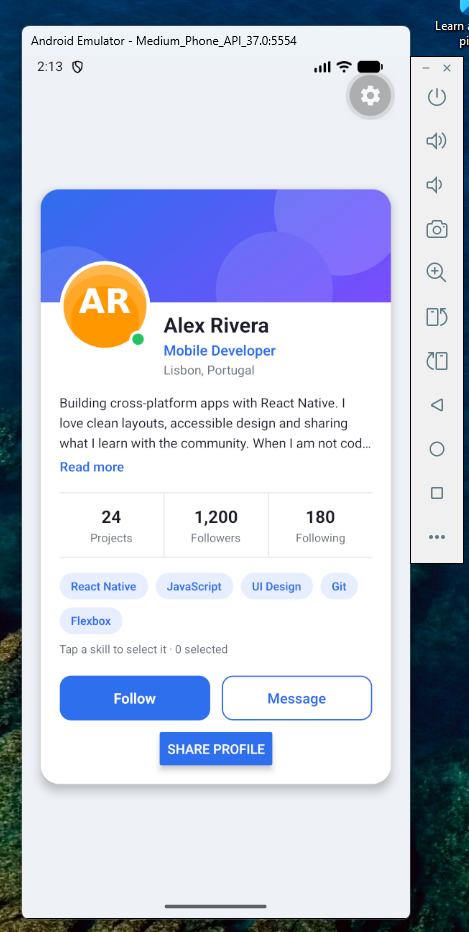
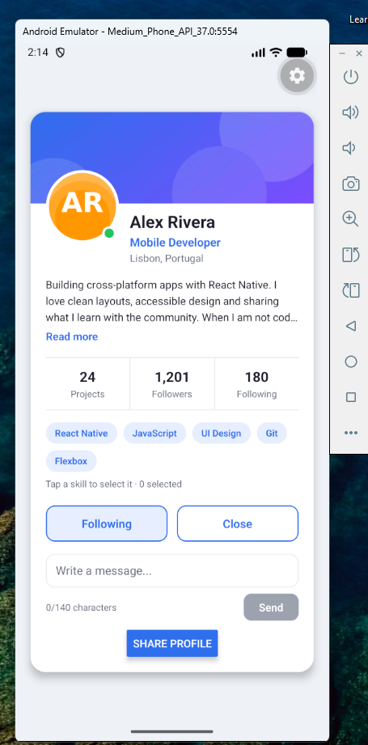

# Interactive Profile Card — Sprint 2

Expo / React Native solution based on the supplied Task 2 starter.

## Run

```sh
npm ci
npm start
```

On Windows PowerShell use `npm.cmd` instead of `npm` if scripts are blocked. Start an Android emulator and press `a` in the Expo terminal, or scan the QR code with a compatible Expo Go app on a phone connected to the same Wi-Fi.

## Features

- Follow/unfollow with a derived follower count of 1,200 or 1,201.
- Message composer with a 140-character limit, counter and disabled Send for blank input.
- Sending shows a native alert, clears the text and closes the composer.
- Expandable biography, online/offline avatar and selectable skills.
- Press feedback and a Share profile button that shows an alert.

All five required steps are implemented. Optional bonus features are not included. Alerts must be checked on Android or iOS; they are not supported by React Native Web.

Checkpoint responses are in [ANSWERS.md](ANSWERS.md).

## Submission

The work branch is `task/interactive-profile-card`, with a commit for each step. Push the branches to a new GitHub repository, open a Pull Request with screenshots or a short recording, and merge it into `main` to meet the LMS submission instructions. Submit the repository link.

## Android screenshots

Initial state:



Following with the message composer open:



The app was tested in the Android emulator. Android, iOS and web exports also passed, along with browser checks for state transitions and message validation.
